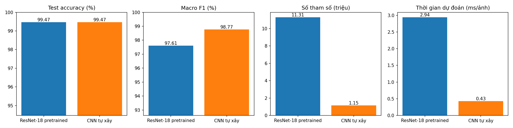
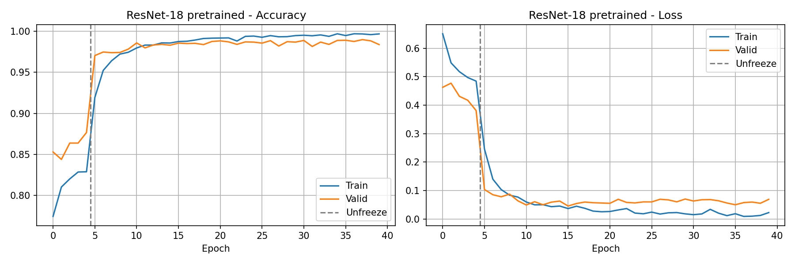
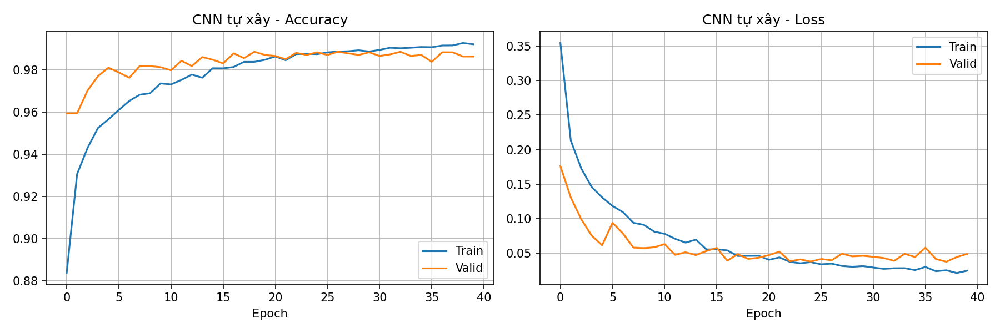
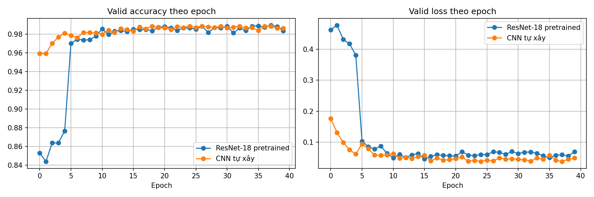
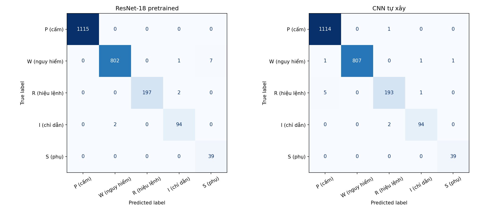
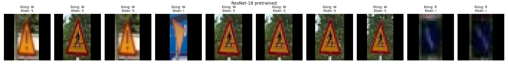
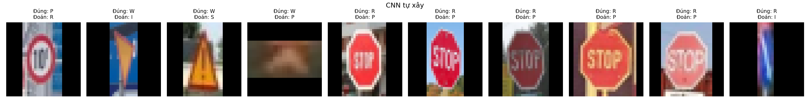

# 🚦 Phân loại biển báo giao thông Việt Nam: so sánh 2 hướng

## Giới thiệu

Dự án phân loại ảnh biển báo giao thông Việt Nam (ảnh đầu vào **32x32x3**) thành 5 nhóm. Bài toán được giải bằng **2 cách** rồi so sánh kết quả:

| | Hướng 1: Kiến trúc có sẵn | Hướng 2: CNN tự xây |# 🚦 Phân loại biển báo giao thông Việt Nam: so sánh 2 hướng

## Giới thiệu

Dự án phân loại ảnh biển báo giao thông Việt Nam (ảnh đầu vào **32x32x3**) thành 5 nhóm. Bài toán được giải bằng **2 cách** rồi so sánh kết quả:

| | Hướng 1: Kiến trúc có sẵn | Hướng 2: CNN tự xây |
|---|---|---|
| Model | **ResNet-18** pretrained trên ImageNet (transfer learning) | CNN gồm 3 khối Conv–BatchNorm–ReLU–Dropout–MaxPool |
| Cách train | Freeze ResNet-18 rồi train lớp phân loại mới (5 epoch), sau đó unfreeze và fine-tune với lr = 1e-4 (35 epoch) | Train từ đầu với Adam (40 epoch) |
| Notebook | `Training/Huong1_ResNet18_pretrained.ipynb` | `Training/Huong2_CNN_tu_xay.ipynb` |

Hai hướng dùng chung dữ liệu, augmentation, batch size và tổng số epoch nên so sánh được với nhau. Code viết theo phong cách các bài trong khoá Deep Learning trên lớp: bài 03/04a cho CNN và augmentation, bài 05b/07 cho các bước transfer learning (freeze → train lớp mới → unfreeze → fine-tune).

Dữ liệu lấy từ file `classification-of-traffic-signs-vn.ndjson`. Từ mỗi ảnh gốc, từng biển báo được cắt ra theo bounding box có sẵn để tạo **35.550 ảnh 32x32**.

## Dữ liệu

| Dữ liệu | Mô tả | Link |
|---|---|---|
| Dataset gốc | ~24.5k ảnh đường phố có bounding box (export `.ndjson` từ Ultralytics Platform) | [Ultralytics Platform](https://platform.ultralytics.com/anh-kiet-pham/datasets/classification-of-traffic-signs-vn) |

Từ dataset gốc, chạy 2 script trong `Data_Pipeline/` (xem mục *Các bước thực hiện*) để tạo bộ 35.550 ảnh biển báo 32x32.

## Phân loại biển báo

| Ký hiệu | Nhóm biển | Đặc điểm nhận dạng | Số ảnh train / val / test |
|---|---|---|---|
| **P** | Biển báo cấm | Hình tròn, viền đỏ | 14886 / 1997 / 1115 |
| **W** | Biển báo nguy hiểm | Hình tam giác, viền đỏ, nền vàng | 9564 / 1432 / 810 |
| **R** | Biển hiệu lệnh | Hình tròn, nền xanh dương | 2716 / 297 / 199 |
| **I** | Biển chỉ dẫn | Hình chữ nhật hoặc vuông, nền xanh dương | 1514 / 182 / 96 |
| **S** | Biển phụ | Hình chữ nhật nhỏ, đi kèm biển chính | 637 / 66 / 39 |

> Ý nghĩa các ký hiệu được suy ra từ quy chuẩn QCVN 41, vì dataset gốc chỉ ghi chữ cái. Lớp IE bị bỏ vì chỉ có 17 ảnh train và không có ảnh nào trong val/test.

## Cấu trúc

```
vietnam-traffic-sign-recognition-main/
├── Data_Pipeline/
│   ├── ndjson_to_yolo.py              # tải ảnh gốc + nhãn (bounding box) từ file .ndjson
│   └── build_cnn_crops.py             # cắt từng biển thành ảnh 32x32
├── Training/                          # chạy trên Google Colab
│   ├── Huong1_ResNet18_pretrained.ipynb  # Hướng 1: transfer learning ResNet-18
│   ├── Huong2_CNN_tu_xay.ipynb        # Hướng 2: CNN tự xây
│   └── So_sanh_2_huong.ipynb          # so sánh, xuất bảng + hình cho slide
├── Inference/
│   └── predict.py                     # dự đoán ảnh mới bằng cả 2 model
├── Utils/helper_functions.py          # resize giữ tỉ lệ + padding
├── test_inputs/                       # ← bỏ ảnh biển báo (đã cắt) cần dự đoán vào đây
└── requirements.txt
```

## Kết quả

Cả 2 model được đánh giá trên cùng tập test gồm 2.259 ảnh (Colab, GPU T4).

| Model | Số tham số | Dung lượng (MB) | Thời gian train (phút) | Thời gian dự đoán (ms/ảnh) | Test accuracy (%) | Macro F1 (%) |
|---|---|---|---|---|---|---|
| ResNet-18 pretrained | 11,309,125 | 45.33 | 11.66 | 2.94 | 99.47 | 97.61 |
| CNN tự xây | 1,149,189 | 4.61 | 2.92 | 0.43 | 99.47 | **98.77** |

**Nhận xét:**
- Hai model có test accuracy bằng nhau, nhưng CNN tự xây **nhỏ hơn ~10 lần**, train **nhanh hơn ~4 lần**, dự đoán **nhanh hơn ~7 lần** và có macro F1 cao hơn.
- Với ảnh 32x32, ResNet-18 giảm kích thước rất nhanh (conv 7x7 stride 2 + MaxPool ở đầu mạng, cuối cùng còn 1x1), nên kiến trúc lớn không tận dụng được hết sức mạnh.
- Điểm yếu của ResNet-18 nằm ở lớp **S (biển phụ)**: precision chỉ 0.85, do một số biển W bị đoán nhầm thành S. CNN tự xây ổn định hơn ở các lớp ít ảnh (S, I, R).
- Dữ liệu lệch lớp nặng (P ~15k ảnh, S chỉ 637 ảnh) nên **macro F1** phản ánh chất lượng model tốt hơn accuracy.

### Precision / Recall / F1 từng lớp

| Lớp | ResNet-18 (P / R / F1) | CNN tự xây (P / R / F1) | Số ảnh test |
|---|---|---|---|
| P (cấm) | 1.0000 / 1.0000 / 1.0000 | 0.9946 / 0.9991 / 0.9969 | 1115 |
| W (nguy hiểm) | 0.9975 / 0.9901 / 0.9938 | 1.0000 / 0.9963 / 0.9981 | 810 |
| R (hiệu lệnh) | 1.0000 / 0.9899 / 0.9949 | 0.9847 / 0.9698 / 0.9772 | 199 |
| I (chỉ dẫn) | 0.9691 / 0.9792 / 0.9741 | 0.9792 / 0.9792 / 0.9792 | 96 |
| S (phụ) | 0.8478 / 1.0000 / 0.9176 | 0.9750 / 1.0000 / 0.9873 | 39 |

### So sánh các chỉ số



### Quá trình train

ResNet-18 (đường nét đứt là lúc unfreeze sau 5 epoch freeze):



CNN tự xây:



So sánh valid accuracy / loss của 2 model:



### Ma trận nhầm lẫn



### Một số ảnh bị đoán sai





## Các bước thực hiện

### 1. Chuẩn bị dữ liệu (trên máy)

```bash
pip install -r requirements.txt
python Data_Pipeline/ndjson_to_yolo.py     # tải ~24.5k ảnh gốc (~1.8 GB) → ../Data_Processed/yolo_dataset
python Data_Pipeline/build_cnn_crops.py    # cắt biển 32x32 → ../Data_Processed/cnn_dataset_32
cd ../Data_Processed && zip -qr cnn_dataset_32.zip cnn_dataset_32
```

> Link ảnh trong file `.ndjson` có hạn sử dụng. Khi link hết hạn, cần export lại file `.ndjson` từ Ultralytics Platform.

### 2. Dự đoán ảnh mới (trên máy)

Bỏ ảnh biển báo đã cắt vào `test_inputs/`, rồi chạy:

```bash
python Inference/predict.py              # hoặc: python Inference/predict.py anh.png
```

Mỗi ảnh được in ra kết quả dự đoán và độ tin cậy của cả 2 model.
|---|---|---|
| Model | **ResNet-18** pretrained trên ImageNet (transfer learning) | CNN gồm 3 khối Conv–BatchNorm–ReLU–Dropout–MaxPool |
| Cách train | Freeze ResNet-18 rồi train lớp phân loại mới (5 epoch), sau đó unfreeze và fine-tune với lr = 1e-4 (35 epoch) | Train từ đầu với Adam (40 epoch) |
| Notebook | `Training/Huong1_ResNet18_pretrained.ipynb` | `Training/Huong2_CNN_tu_xay.ipynb` |

Hai hướng dùng chung dữ liệu, augmentation, batch size và tổng số epoch nên so sánh được với nhau. Code viết dựa theo các labs trên lớp: bài 03/04a cho CNN và augmentation, bài 05b/07 cho các bước transfer learning.

Dữ liệu lấy từ file `classification-of-traffic-signs-vn.ndjson`. Từ mỗi ảnh gốc, từng biển báo được cắt ra theo bounding box có sẵn để tạo **35.550 ảnh 32x32**.

## Dữ liệu

| Dữ liệu | Mô tả | Link |
|---|---|---|
| Dataset gốc | ~24.5k ảnh đường phố có bounding box (export `.ndjson` từ Ultralytics Platform) | [Ultralytics Platform](https://platform.ultralytics.com/anh-kiet-pham/datasets/classification-of-traffic-signs-vn) |

Từ dataset gốc, chạy 2 script trong `Data_Pipeline/` (xem mục *Các bước thực hiện*) để tạo bộ 35.550 ảnh biển báo 32x32.
=======
| Dataset gốc | ~24.5k ảnh đường phố có bounding box (export `.ndjson` từ Ultralytics Platform) | [TODO: link dataset gốc](#) |
| `cnn_dataset_32.zip` | 35.550 ảnh biển báo đã cắt 32x32, chia sẵn train/val/test (~74 MB) | [TODO: link Google Drive](#) |

Chỉ cần tải `cnn_dataset_32.zip` là train được ngay, không phải chạy lại bước chuẩn bị dữ liệu.
>>>>>>> a7f1b9edaaeb1fae78149ed37ed06d9267fa7fbd

## Phân loại biển báo

| Ký hiệu | Nhóm biển | Đặc điểm nhận dạng | Số ảnh train / val / test |
|---|---|---|---|
| **P** | Biển báo cấm | Hình tròn, viền đỏ | 14886 / 1997 / 1115 |
| **W** | Biển báo nguy hiểm | Hình tam giác, viền đỏ, nền vàng | 9564 / 1432 / 810 |
| **R** | Biển hiệu lệnh | Hình tròn, nền xanh dương | 2716 / 297 / 199 |
| **I** | Biển chỉ dẫn | Hình chữ nhật hoặc vuông, nền xanh dương | 1514 / 182 / 96 |
| **S** | Biển phụ | Hình chữ nhật nhỏ, đi kèm biển chính | 637 / 66 / 39 |


## Cấu trúc

```
vietnam-traffic-sign-recognition-main/
├── Data_Pipeline/
│   ├── ndjson_to_yolo.py              # tải ảnh gốc + nhãn (bounding box) từ file .ndjson
│   └── build_cnn_crops.py             # cắt từng biển thành ảnh 32x32
├── Training/                          # chạy trên Google Colab
│   ├── Huong1_ResNet18_pretrained.ipynb  # Hướng 1: transfer learning ResNet-18
│   ├── Huong2_CNN_tu_xay.ipynb        # Hướng 2: CNN tự xây
│   └── So_sanh_2_huong.ipynb          # so sánh, xuất bảng + hình cho slide
├── Inference/
│   └── predict.py                     # dự đoán ảnh mới bằng cả 2 model
├── Utils/helper_functions.py          # resize giữ tỉ lệ + padding
├── test_inputs/                       # ← bỏ ảnh biển báo (đã cắt) cần dự đoán vào đây
└── requirements.txt
```

## Kết quả

<<<<<<< HEAD
Cả 2 model được đánh giá trên cùng tập test gồm 2.259 ảnh.
=======
Cả 2 model được đánh giá trên cùng tập test gồm 2.259 ảnh (Colab, GPU T4).
>>>>>>> a7f1b9edaaeb1fae78149ed37ed06d9267fa7fbd

| Model | Số tham số | Dung lượng (MB) | Thời gian train (phút) | Thời gian dự đoán (ms/ảnh) | Test accuracy (%) | Macro F1 (%) |
|---|---|---|---|---|---|---|
| ResNet-18 pretrained | 11,309,125 | 45.33 | 11.66 | 2.94 | 99.47 | 97.61 |
| CNN tự xây | 1,149,189 | 4.61 | 2.92 | 0.43 | 99.47 | **98.77** |

<<<<<<< HEAD
=======
**Nhận xét:**
- Hai model có test accuracy bằng nhau, nhưng CNN tự xây **nhỏ hơn ~10 lần**, train **nhanh hơn ~4 lần**, dự đoán **nhanh hơn ~7 lần** và có macro F1 cao hơn.
- Với ảnh 32x32, ResNet-18 giảm kích thước rất nhanh (conv 7x7 stride 2 + MaxPool ở đầu mạng, cuối cùng còn 1x1), nên kiến trúc lớn không tận dụng được hết sức mạnh.
- Điểm yếu của ResNet-18 nằm ở lớp **S (biển phụ)**: precision chỉ 0.85, do một số biển W bị đoán nhầm thành S. CNN tự xây ổn định hơn ở các lớp ít ảnh (S, I, R).
- Dữ liệu lệch lớp nặng (P ~15k ảnh, S chỉ 637 ảnh) nên **macro F1** phản ánh chất lượng model tốt hơn accuracy.
>>>>>>> a7f1b9edaaeb1fae78149ed37ed06d9267fa7fbd

### Precision / Recall / F1 từng lớp

| Lớp | ResNet-18 (P / R / F1) | CNN tự xây (P / R / F1) | Số ảnh test |
|---|---|---|---|
| P (cấm) | 1.0000 / 1.0000 / 1.0000 | 0.9946 / 0.9991 / 0.9969 | 1115 |
| W (nguy hiểm) | 0.9975 / 0.9901 / 0.9938 | 1.0000 / 0.9963 / 0.9981 | 810 |
| R (hiệu lệnh) | 1.0000 / 0.9899 / 0.9949 | 0.9847 / 0.9698 / 0.9772 | 199 |
| I (chỉ dẫn) | 0.9691 / 0.9792 / 0.9741 | 0.9792 / 0.9792 / 0.9792 | 96 |
| S (phụ) | 0.8478 / 1.0000 / 0.9176 | 0.9750 / 1.0000 / 0.9873 | 39 |

### So sánh các chỉ số


### Quá trình train

ResNet-18 (đường nét đứt là lúc unfreeze sau 5 epoch freeze):


CNN tự xây:


So sánh valid accuracy / loss của 2 model:


### Ma trận nhầm lẫn


### Một số ảnh bị đoán sai


## Các bước thực hiện

### 1. Chuẩn bị dữ liệu (trên máy)

```bash
pip install -r requirements.txt
python Data_Pipeline/ndjson_to_yolo.py     # tải ~24.5k ảnh gốc (~1.8 GB) → ../Data_Processed/yolo_dataset
python Data_Pipeline/build_cnn_crops.py    # cắt biển 32x32 → ../Data_Processed/cnn_dataset_32
cd ../Data_Processed && zip -qr cnn_dataset_32.zip cnn_dataset_32
```

> Link ảnh trong file `.ndjson` có hạn sử dụng. Khi link hết hạn, cần export lại file `.ndjson` từ Ultralytics Platform.


### 3. Dự đoán ảnh mới (trên máy)

Bỏ ảnh biển báo đã cắt vào `test_inputs/`, rồi chạy:

```bash
python Inference/predict.py              # hoặc: python Inference/predict.py anh.png
```

Mỗi ảnh được in ra kết quả dự đoán và độ tin cậy của cả 2 model.
